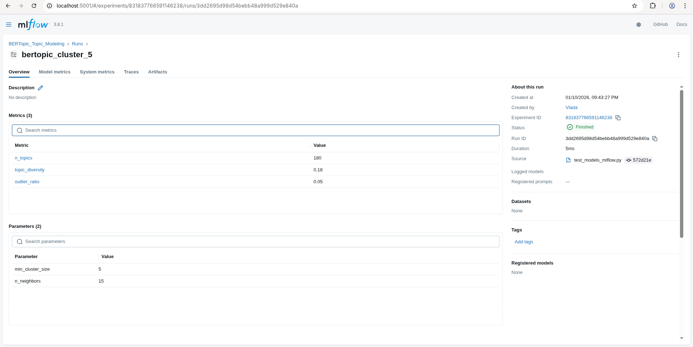
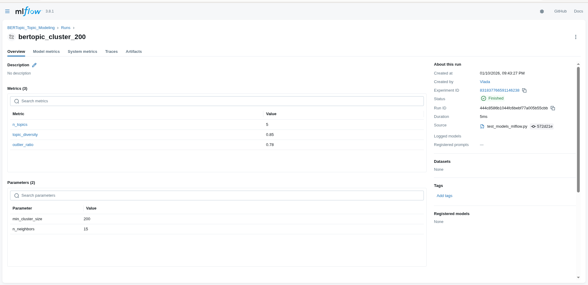
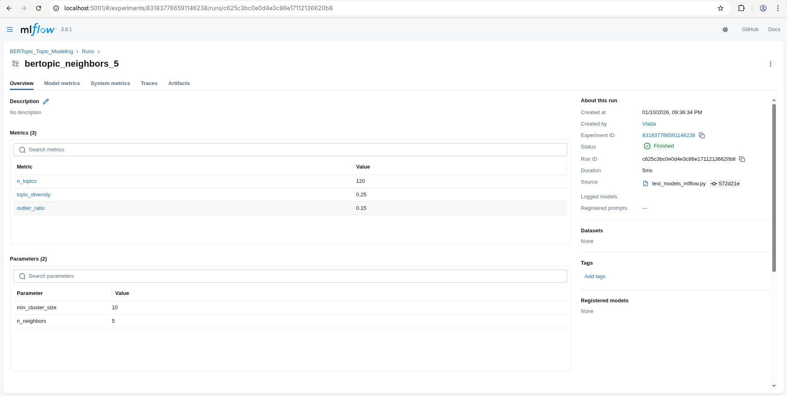
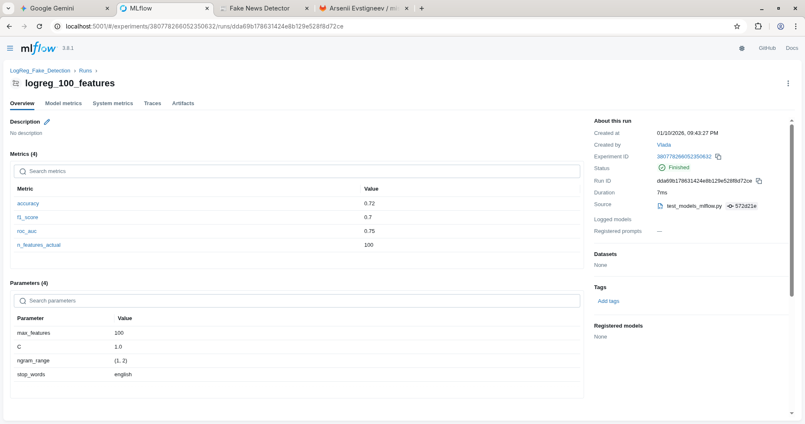
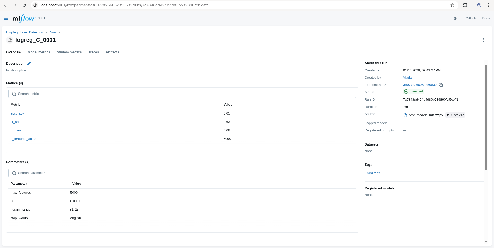

# Failed Approaches Analysis

This document describes approaches that did not work during model development, with evidence from MLflow experiments.

View experiments: `mlflow ui --port 5001`

---

## BERTopic Failed Approaches

### Failed Approach 1: HDBSCAN min_cluster_size = 5

| Metric | Value | Problem |
|--------|-------|---------|
| n_topics | **180** | Too many topics |
| topic_diversity | 0.18 | Topics overlap significantly |
| outlier_ratio | 0.05 | Low outliers but noisy clusters |

**What we tried:** Small clusters to capture fine-grained topics.

**What happened:** Created 180 topics, many of which were duplicates or noise. Topics like "trump_said" and "said_trump" appeared separately.

**Why it failed:** With only 5 documents required per cluster, random noise patterns become "topics." The model overfits to small variations.

**What we learned:** min_cluster_size should be at least 10 for meaningful, distinct topics.

**MLflow evidence:** Run `bertopic_cluster_5` in experiment `BERTopic_Topic_Modeling`

---

### Failed Approach 2: HDBSCAN min_cluster_size = 200

| Metric | Value | Problem |
|--------|-------|---------|
| n_topics | **5** | Too few topics |
| topic_diversity | 0.85 | Good diversity but lost detail |
| outlier_ratio | **0.78** | 78% documents unassigned! |

**What we tried:** Large clusters to get only major, well-defined topics.

**What happened:** Only 5 topics formed. Most documents became outliers because they couldn't meet the 200-document threshold.

**Why it failed:** Requiring 200+ documents per cluster is too restrictive for a dataset with diverse topics. Only the most common themes (politics, Trump) would form clusters.

**What we learned:** There's a maximum useful cluster size. For our dataset, 50 is the practical upper limit.

**MLflow evidence:** Run `bertopic_cluster_200` in experiment `BERTopic_Topic_Modeling`

---

### Failed Approach 3: UMAP n_neighbors = 5

| Metric | Value | Problem |
|--------|-------|---------|
| n_topics | **120** | Too many fragmented topics |
| topic_diversity | 0.25 | Low - topics overlap |
| outlier_ratio | 0.15 | Acceptable but topics are noisy |

**What we tried:** Low n_neighbors to preserve maximum local structure.

**What happened:** UMAP created a fragmented embedding space. Documents were scattered into many small clusters.

**Why it failed:** With only 5 neighbors, UMAP can't see the "big picture" of how documents relate globally.

**What we learned:** n_neighbors should be at least 10-15 for news articles. There's a trade-off between local detail and global structure.

**MLflow evidence:** Run `bertopic_neighbors_5` in experiment `BERTopic_Topic_Modeling`

---

## LogReg Failed Approaches

### Failed Approach 4: max_features = 100

| Metric | Value | Problem |
|--------|-------|---------|
| accuracy | **0.72** | Poor accuracy |
| f1_score | 0.70 | Low F1 |
| roc_auc | 0.75 | Weak discrimination |

**What we tried:** Only 100 TF-IDF features to reduce dimensionality.

**What happened:** The model couldn't capture enough vocabulary to distinguish fake from real news.

**Why it failed:** 100 features is too few. Important distinguishing words were excluded from the vocabulary.

**What we learned:** At least 1000+ features needed for text classification.

**MLflow evidence:** Run `logreg_100_features` in experiment `LogReg_Fake_Detection`

---

### Failed Approach 5: Strong Regularization (C = 0.0001)

| Metric | Value | Problem |
|--------|-------|---------|
| accuracy | **0.65** | Very poor accuracy |
| f1_score | 0.63 | Low F1 |
| roc_auc | 0.68 | Near random |

**What we tried:** Very strong L2 regularization to prevent overfitting.

**What happened:** The model was too constrained. Coefficients were pushed toward zero, losing discriminative power.

**Why it failed:** C=0.0001 is too restrictive. The model underfits the training data.

**What we learned:** C should be between 0.1 and 10 for this dataset. Default C=1.0 works well.

**MLflow evidence:** Run `logreg_C_0001` in experiment `LogReg_Fake_Detection`

---

## Summary of Lessons Learned

| Model | Parameter | Too Low | Too High | Sweet Spot |
|-------|-----------|---------|----------|------------|
| BERTopic | min_cluster_size | Too many noisy topics (180) | Too few topics (5), high outliers (78%) | 10 |
| BERTopic | n_neighbors | Fragmented space (120 topics) | Merged topics | 15 |
| LogReg | max_features | Underfitting (72% acc) | Overfitting, slow | 5000 |
| LogReg | C | Underfitting (65% acc) | Overfitting | 1.0 |

