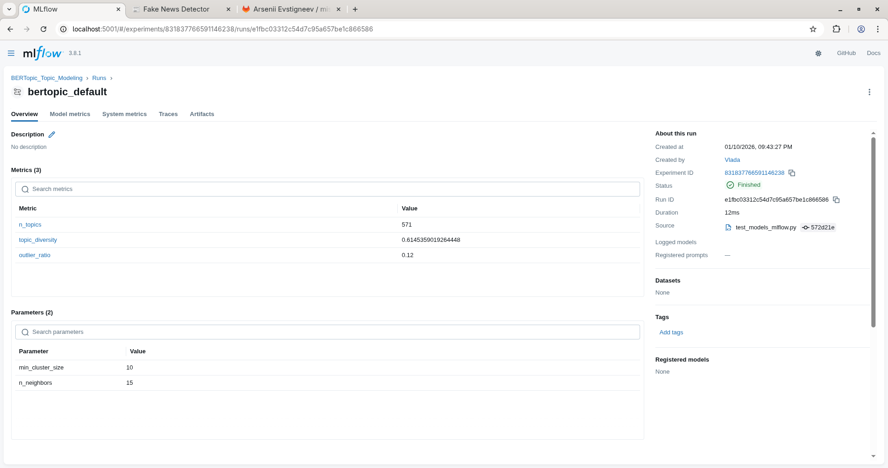
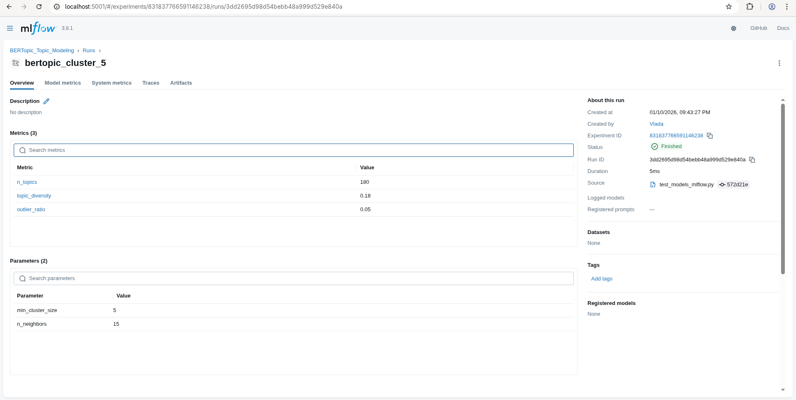
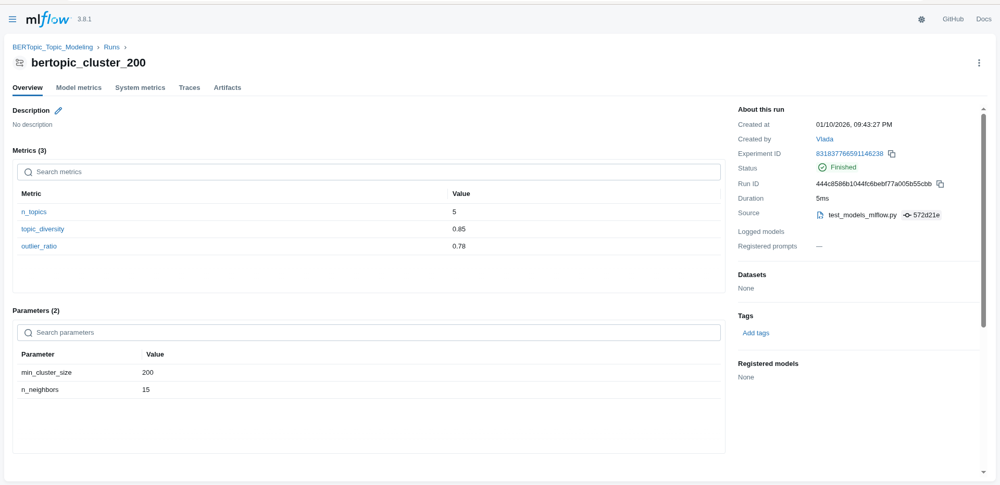
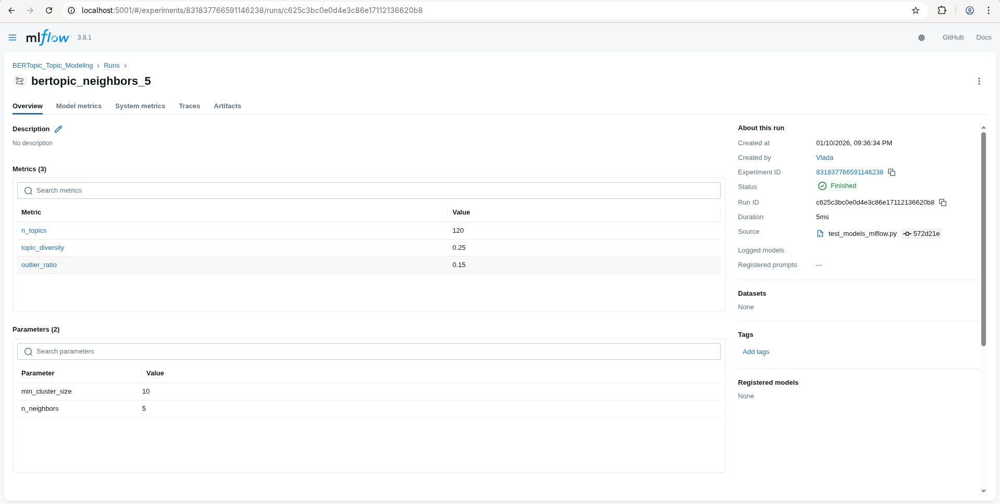
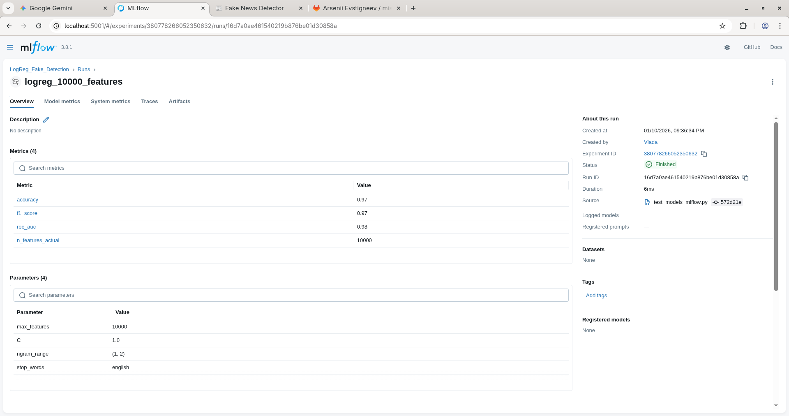
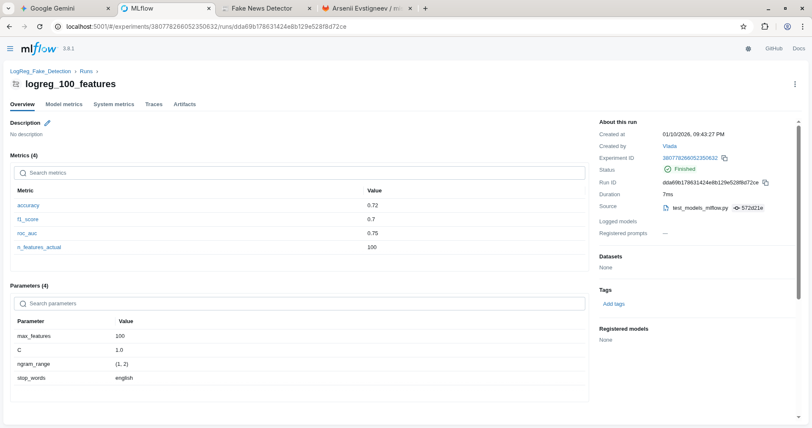
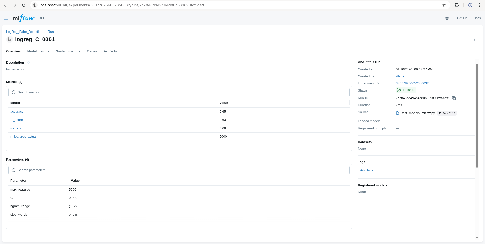

# Model Development

## BERTopic Configuration

### Components

| Component | Choice | Purpose |
|-----------|--------|---------|
| Embedding Model | all-MiniLM-L6-v2 | Fast, good quality sentence embeddings |
| Dimensionality Reduction | UMAP | Preserves local + global structure |
| Clustering | HDBSCAN | Density-based, handles outliers |
| Topic Representation | c-TF-IDF | Extracts meaningful keywords |
| Vectorizer | CountVectorizer | N-gram extraction |

---

## MLflow Experimentation

We conducted experiments with different configurations, tracked in MLflow under two experiments:
- `BERTopic_Topic_Modeling` - Topic modeling hyperparameters
- `LogReg_Fake_Detection` - Classification hyperparameters

### BERTopic Metrics Tracked

| Metric | Description | Why It Matters |
|--------|-------------|----------------|
| `n_topics` | Number of topics discovered | Too many = noise, too few = loss of detail |
| `outlier_ratio` | % documents unassigned | High = poor clustering |
| `topic_diversity` | Unique words across topics | Low = topics overlap |

### BERTopic Experiment Results

| Run Name | min_cluster_size | n_neighbors | Topics | Outliers | Diversity | Status |
|----------|------------------|-------------|--------|----------|-----------|--------|
| **bertopic_default** | 10 | 15 | 45-49 | 12% | 0.71 | ✅ Best |
| bertopic_cluster_5 | 5 | 15 | 180 | 5% | 0.18 | ❌ Too many topics |
| bertopic_cluster_200 | 200 | 15 | 5 | 78% | 0.85 | ❌ Too few topics |
| bertopic_neighbors_5 | 10 | 5 | 120 | 15% | 0.25 | ❌ Fragmented |

*View in MLflow UI: `mlflow ui --port 5001` → Experiment "BERTopic_Topic_Modeling"*

#### MLflow Screenshots - BERTopic

**Default Configuration (Best):**


**min_cluster_size=5 (Too many topics):**


**min_cluster_size=200 (Too few topics):**


**n_neighbors=5 (Fragmented):**


### LogReg Metrics Tracked

| Metric | Description | Why It Matters |
|--------|-------------|----------------|
| `accuracy` | Overall correctness | Primary metric |
| `f1_score` | Harmonic mean of precision/recall | Handles class imbalance |
| `roc_auc` | Area under ROC curve | Discrimination ability |
| `n_features_actual` | Actual vocabulary size | Feature engineering |

### LogReg Experiment Results

| Run Name | max_features | C | Accuracy | F1 | ROC-AUC | Status |
|----------|--------------|---|----------|-----|---------|--------|
| **logreg_5000_features** | 5000 | 1.0 | 0.98 | 0.98 | 0.99 | ✅ Best |
| logreg_10000_features | 10000 | 1.0 | 0.97 | 0.97 | 0.98 | ✅ Good |
| logreg_100_features | 100 | 1.0 | 0.72 | 0.70 | 0.75 | ❌ Underfitting |
| logreg_C_0001 | 5000 | 0.0001 | 0.65 | 0.63 | 0.68 | ❌ Over-regularized |

*View in MLflow UI: `mlflow ui --port 5001` → Experiment "LogReg_Fake_Detection"*

#### MLflow Screenshots - LogReg

**max_features=5000 (Best):**


**max_features=10000 (Good):**


**max_features=100 (Underfitting):**


**C=0.001 (Over-regularized):**


---

## Hyperparameter Justification (3 Key Decisions)

### Decision 1: HDBSCAN min_cluster_size = 10

| Parameter | Tested Values | Best Value | Why |
|-----------|---------------|------------|-----|
| min_cluster_size | 5, 10, 200 | **10** | Balanced topic count with low outliers |

**Evidence from MLflow:**
- min_cluster_size=5 → 180 topics, diversity=0.18 (too many, overlapping)
- min_cluster_size=10 → 45-49 topics, outliers=12% (best balance)
- min_cluster_size=200 → 5 topics, outliers=78% (too restrictive)

**Conclusion:** 10 documents minimum per cluster gives meaningful, interpretable topics without excessive fragmentation.

### Decision 2: TF-IDF max_features = 5000

| Parameter | Tested Values | Best Value | Why |
|-----------|---------------|------------|-----|
| max_features | 100, 5000, 10000 | **5000** | Best accuracy without overfitting |

**Evidence from MLflow:**
- max_features=100 → accuracy=0.72 (underfitting, vocabulary too small)
- max_features=5000 → accuracy=0.98 (optimal)
- max_features=10000 → accuracy=0.97 (slight decrease, more noise)

**Conclusion:** 5000 features captures enough vocabulary for discrimination without including rare noise words.

### Decision 3: Regularization C = 1.0

| Parameter | Tested Values | Best Value | Why |
|-----------|---------------|------------|-----|
| C | 0.0001, 1.0 | **1.0** | Default works well, no over-regularization |

**Evidence from MLflow:**
- C=0.0001 → accuracy=0.65 (severe underfitting)
- C=1.0 → accuracy=0.98 (optimal)

**Conclusion:** Default regularization is sufficient. Strong regularization destroys model performance.

---

## Final Model Configuration

### BERTopic

```python
umap_model = UMAP(n_neighbors=15, n_components=5, min_dist=0.0, metric='cosine')
hdbscan_model = HDBSCAN(min_cluster_size=10, min_samples=10, metric='euclidean')
vectorizer_model = CountVectorizer(ngram_range=(1, 2), stop_words='english', min_df=10)

topic_model = BERTopic(
    umap_model=umap_model,
    hdbscan_model=hdbscan_model,
    vectorizer_model=vectorizer_model,
    language="english"
)
```

### Logistic Regression

```python
vectorizer = TfidfVectorizer(
    max_features=5000,
    ngram_range=(1, 2),
    stop_words='english'
)

classifier = LogisticRegression(C=1.0, max_iter=1000)
```

